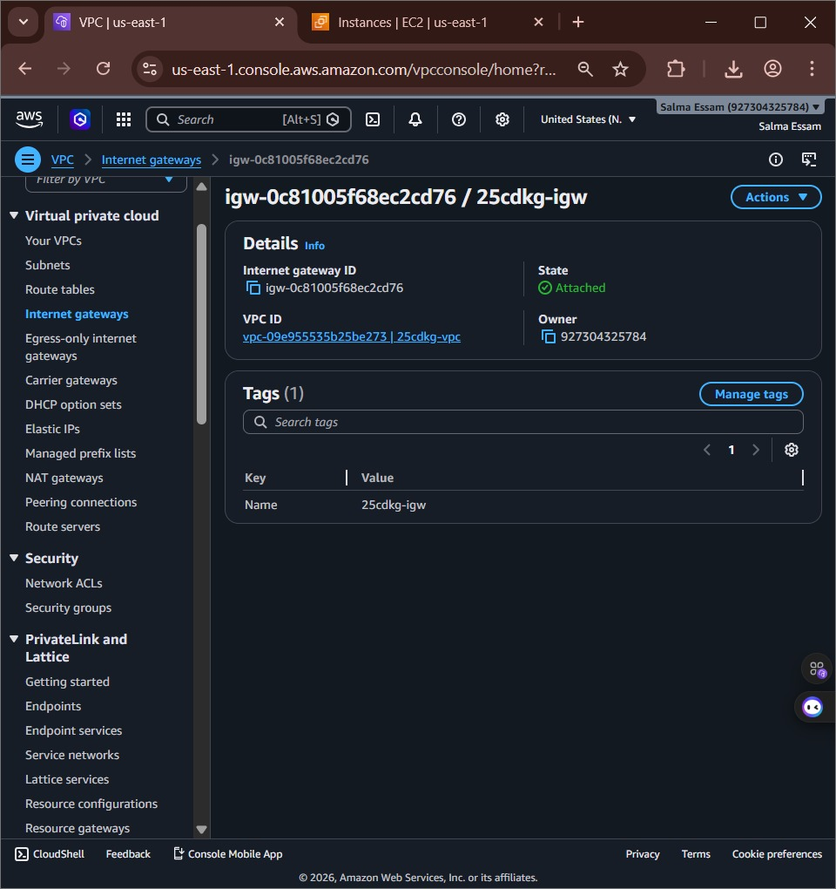
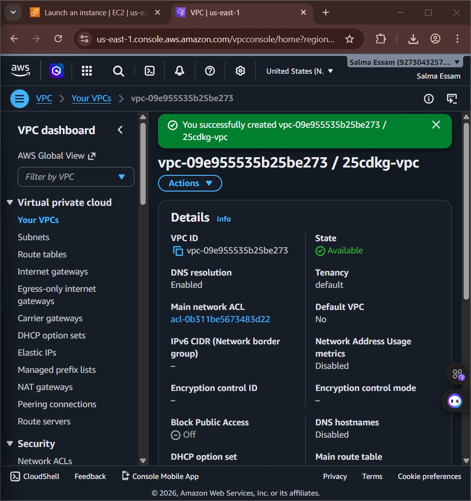
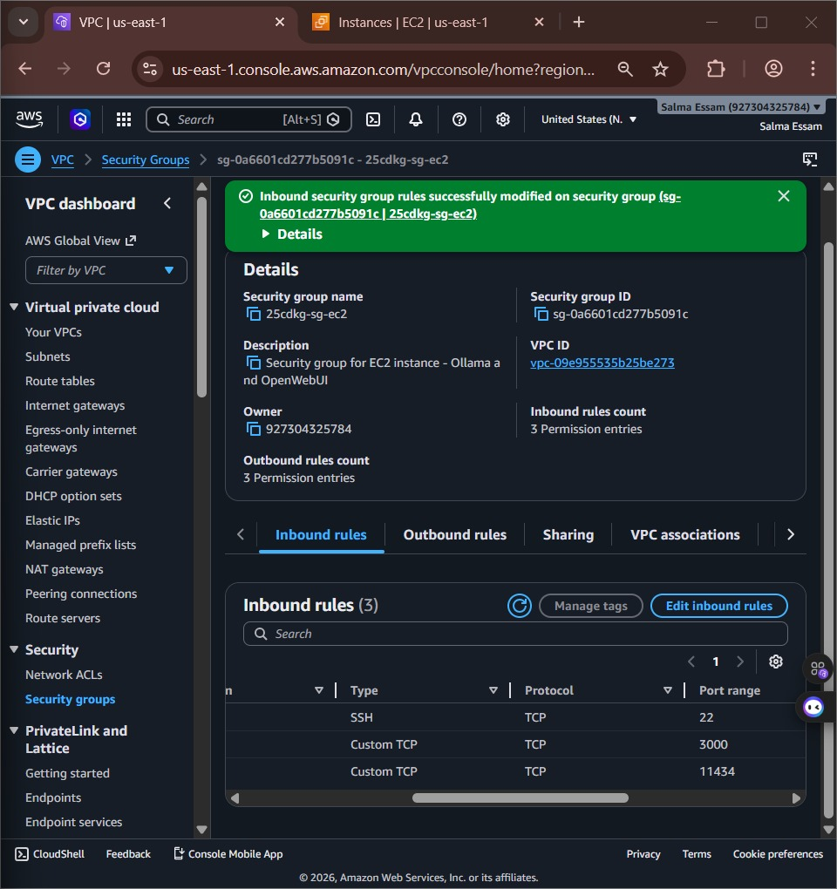
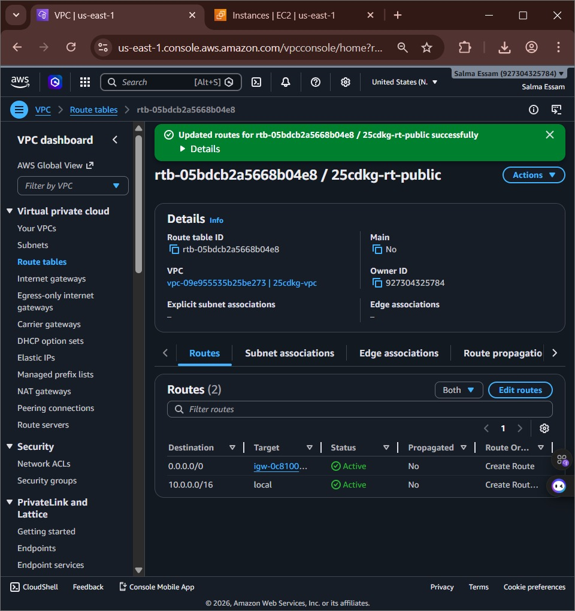
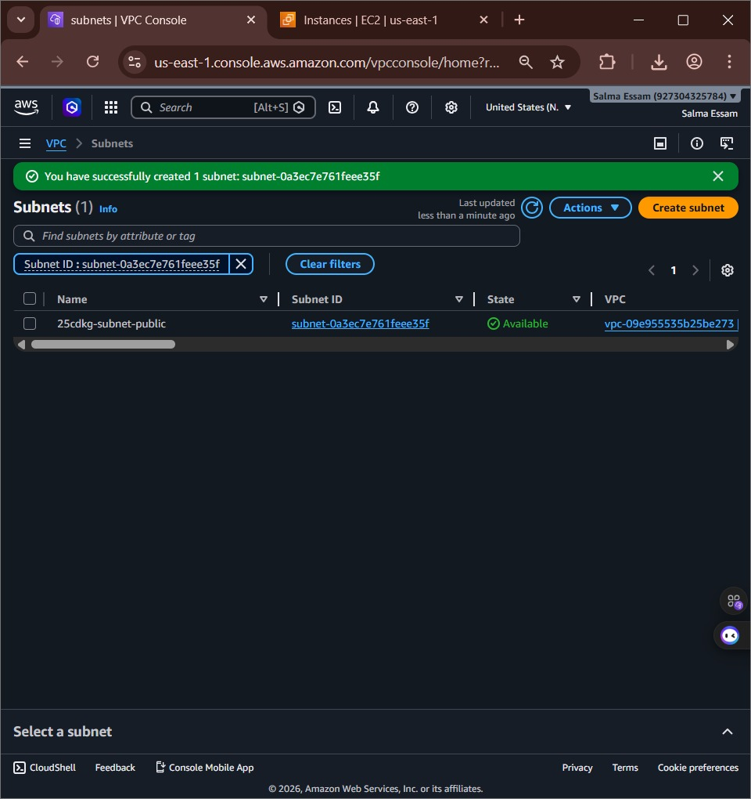
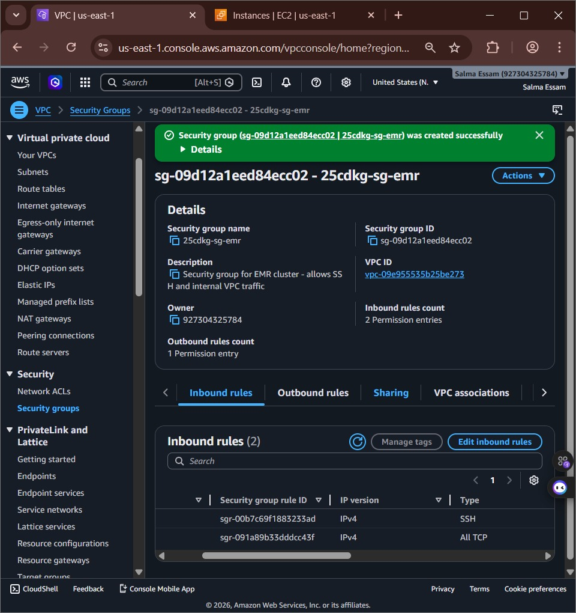
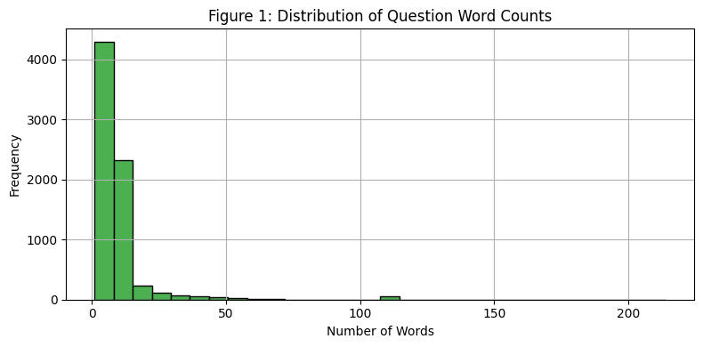
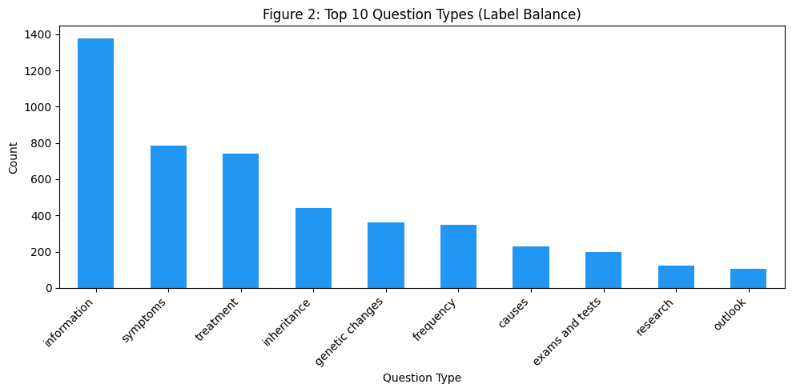
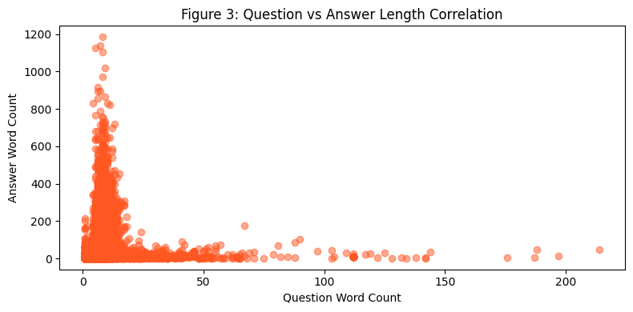
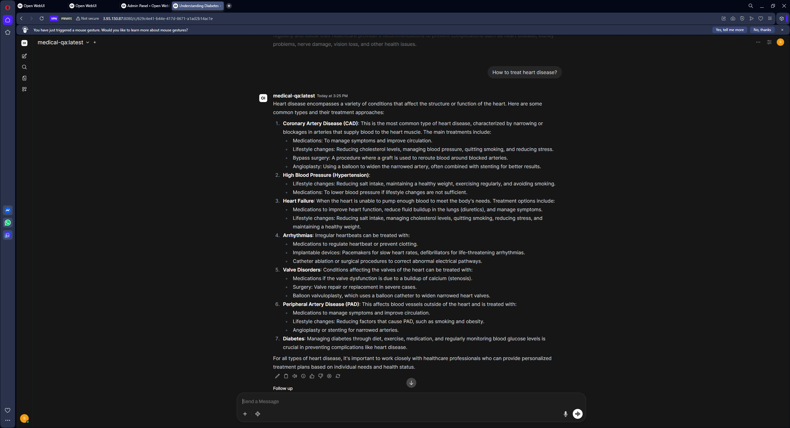

# Medical Chat Assistant

A cloud-hosted medical question-answering assistant built on a fine-tuned open-source language model. The solution covers the full pipeline: data engineering on Apache Spark, domain adaptation with LoRA, and private deployment on AWS behind a browser-based chat interface.

> **Disclaimer:** This system is intended for informational purposes only. It does not provide medical advice, diagnosis, or treatment, and it must not replace consultation with a qualified healthcare professional.

---

## Table of Contents

1. [Project Background](#project-background)
2. [Solution Overview](#solution-overview)
3. [Architecture](#architecture)
4. [Dataset](#dataset)
5. [Data Processing Pipeline](#data-processing-pipeline)
6. [Model and Fine-Tuning](#model-and-fine-tuning)
7. [Evaluation](#evaluation)
8. [Deployment](#deployment)
9. [Infrastructure Cost](#infrastructure-cost)
10. [Repository Structure](#repository-structure)
11. [Reproducing the Project](#reproducing-the-project)

---

## Project Background

This project was delivered in response to a client request for a domain-specific medical assistant with the following requirements:

- Answers grounded in a trusted medical question-and-answer corpus.
- A lightweight open-source model that can be trained and served at low cost.
- Hosting inside an isolated, access-controlled cloud network.
- A web interface that is available to end users without any local installation and that recovers automatically after a server restart.
- Controlled infrastructure spend, with temporary compute resources released as soon as they are no longer needed.

## Solution Overview

| Area | Choice |
|------|--------|
| Data source | MedQuAD medical Q&A dataset |
| Data processing | Apache Spark on Amazon EMR |
| Storage | Amazon S3 (data lake and model archive) |
| Base model | Qwen 2.5 1.5B Instruct (4-bit quantized) |
| Fine-tuning | LoRA via Unsloth and Hugging Face TRL |
| Model format | GGUF (`q4_k_m`) |
| Inference engine | Ollama on a GPU-backed Amazon EC2 instance |
| User interface | Open WebUI running in Docker |
| Network | Custom Amazon VPC with scoped security groups |

## Architecture

The system follows a five-stage flow:

1. **Ingestion:** The raw dataset is stored in an Amazon S3 bucket that acts as the central data lake.
2. **Preprocessing:** An Amazon EMR cluster running Apache Spark cleans, formats, and splits the data, then writes the results back to S3.
3. **Fine-tuning:** The training split is used to adapt the base model with LoRA. The result is exported to GGUF.
4. **Serving:** The GGUF model is loaded by Ollama on a GPU-enabled EC2 instance (`g4dn.xlarge`, NVIDIA T4) and exposed through an HTTP API on port `11434`.
5. **User interaction:** Open WebUI connects to the Ollama API and provides the chat interface in the browser.

### Network Design

| Component | Configuration |
|-----------|---------------|
| VPC | Dedicated custom VPC, CIDR `10.0.0.0/16`, region `us-east-1` |
| Public subnet (`10.0.3.0/24`) | Hosts the EC2 instance running Ollama and Open WebUI; routed to the internet through an Internet Gateway |
| Private subnet (`10.0.2.0/24`) | Hosts the EMR cluster; no direct internet exposure |
| Route table | `0.0.0.0/0` to the Internet Gateway and `10.0.0.0/16` local, associated with the public subnet only |

### Security Groups

**EC2 instance**

| Port | Source | Purpose |
|------|--------|---------|
| 22 (SSH) | Administrator IP only | Remote administration |
| Web UI port | Public | Browser access to the chat interface |
| 11434 | VPC CIDR (`10.0.0.0/16`) | Internal access to the Ollama API; not exposed publicly |

**EMR cluster**

| Port | Source | Purpose |
|------|--------|---------|
| 22 (SSH) | Administrator IP only | Cluster administration and job debugging |
| All TCP | Same security group | Intra-cluster communication (HDFS, YARN, Spark shuffle) |

<details>
<summary>Network configuration screenshots</summary>








</details>

## Dataset

| Property | Detail |
|----------|--------|
| Name | MedQuAD (Medical Question and Answer Dataset) |
| License | CC0 1.0 Universal (Public Domain) |
| Raw size | 38,088 rows |
| Columns | `qtype`, `Question`, `Answer` |
| Question categories | 31 distinct types (for example treatment, symptoms, susceptibility) |
| Clean samples | 17,364 after preprocessing |

## Data Processing Pipeline

The preprocessing job (`Data_Preprocessing.py`) runs on EMR as a Spark step and applies the following transformations:

1. Load the raw CSV from S3.
2. Normalize text (lowercase, trim whitespace).
3. Remove rows with missing questions or answers.
4. Compute question and answer word counts.
5. Filter outliers: questions under 5 words, answers under 10 words, and answers over 500 words (to stay within the 2,048-token context window).
6. Remove duplicate question-answer pairs and collapse repeated whitespace.
7. Normalize the `qtype` label.
8. Format every sample with the ChatML template used by Qwen 2.5.
9. Apply a character-level safety filter.
10. Split into train, validation, and test sets and export each split to S3 as JSON.

### Data Splits

| Split | Share | Samples |
|-------|-------|---------|
| Train | 70% | 12,033 |
| Validation | 15% | 2,507 |
| Test | 15% | 2,483 |

Deduplication runs before splitting, the split uses a fixed seed (`42`), and the test set is never used during training or tuning, which prevents data leakage.

### Exploratory Analysis

| | |
|---|---|
|  |  |
|  |  |


### EMR Cluster

| Property | Value |
|----------|-------|
| EMR release | 7.0.0 (Spark 3.5.0, Hadoop) |
| Nodes | 1 primary, 1 core, 1 task (`m5.xlarge`) |
| Auto-termination | Enabled after 1 hour idle |
| Status | Terminated after the preprocessing step completed |

## Model and Fine-Tuning

**Base model:** `unsloth/qwen2.5-1.5b-instruct-bnb-4bit` (Apache 2.0)

The 1.5B-parameter model with 4-bit quantization uses roughly 0.9 GB of memory, which fits on a single 16 GB T4 GPU. Its native ChatML format also matches the prompt template applied during preprocessing.

### LoRA Configuration

| Parameter | Value |
|-----------|-------|
| Rank (`r`) | 16 |
| Alpha | 16 |
| Dropout | 0 |
| Bias | none |
| Target modules | `q_proj`, `k_proj`, `v_proj`, `o_proj`, `gate_proj`, `up_proj`, `down_proj` |

### Training Configuration

| Parameter | Value |
|-----------|-------|
| Trainer | Hugging Face TRL `SFTTrainer` |
| Hardware | NVIDIA Tesla T4 (16 GB) |
| Max sequence length | 2,048 tokens |
| Learning rate | 2e-4 (linear schedule, 50 warmup steps) |
| Batch size | 1 per device, 8 gradient accumulation steps (effective 8) |
| Epochs | 2 (about 3,000 optimization steps) |
| Optimizer | `adamw_8bit` |
| Weight decay | 0.01 |
| Evaluation interval | Every 500 steps |
| Seed | 42 |


Training and validation loss decrease together and level off at around 2,000 steps, with no sign of overfitting.

After training, the model was exported to GGUF with `q4_k_m` quantization, which balances output quality against file size and is the format required by Ollama.

## Evaluation

The fine-tuned model was evaluated on 100 samples from the held-out test split.

| Metric | Score |
|--------|-------|
| ROUGE-1 | 0.4199 |
| ROUGE-2 | 0.2319 |
| ROUGE-L | 0.3171 |
| BLEU | 0.1628 |


In side-by-side tests against the base model using identical generation settings, the fine-tuned model produced complete, concise answers in the style of the training corpus, while the base model tended to give generic list-style answers that were often cut off at the token limit.

## Deployment

### Compute

| Property | Value |
|----------|-------|
| Instance type | `g4dn.xlarge` (1x NVIDIA T4, 4 vCPUs, 16 GB RAM) |
| OS | Ubuntu (Linux) |
| Placement | Public subnet of the custom VPC |
| Inference engine | Ollama |
| Registered model name | `medical-qa` |

### Interface

Open WebUI runs as a Docker container on the same instance and communicates with Ollama through the local API. The container is started with `--restart always`, so the interface comes back automatically after a reboot or a crash.



### Model Archive

The fine-tuned model weights are archived in Amazon S3 for reproducibility.

## Infrastructure Cost

Total spend for the full build, including preprocessing, deployment, and testing, was approximately **$19.90**.

| Service | Cost (USD) |
|---------|-----------|
| EC2 instances (GPU inference host) | 14.92 |
| Elastic MapReduce | 1.22 |
| Elastic Load Balancing | 0.65 |
| EC2 other | 0.52 |
| VPC | 0.47 |
| S3 | 0.02 |
| Tax | 2.10 |

Cost was controlled by using a small quantized model, free-tier GPU training, and a short-lived EMR cluster that was terminated immediately after preprocessing.

## Repository Structure

```
.
├── AWS_Images/               Infrastructure and deployment screenshots
├── EDA_Images/               Exploratory data analysis charts
├── Model_Images/             Training curves and evaluation charts
├── Complete_Code_MQA.ipynb   End-to-end notebook
├── Data_Preprocessing.py     PySpark preprocessing job (runs on EMR)
├── Fine_Tuning.ipynb         LoRA fine-tuning and GGUF export notebook
├── requirements.txt          Python dependencies
└── README.md
```

## Reproducing the Project

### 1. Preprocess the data

Upload the raw dataset to S3, create an EMR cluster with Spark inside the VPC, and submit `Data_Preprocessing.py` as an EMR step. The cleaned train, validation, and test splits are written back to S3.

### 2. Fine-tune the model

Open `Fine_Tuning.ipynb` on a GPU runtime (a free T4 is sufficient), install the dependencies, and run all cells. The notebook trains the LoRA adapter, evaluates the model, and exports the GGUF file.

```bash
pip install -r requirements.txt
```

### 3. Deploy on EC2

Install Ollama on the GPU instance:

```bash
curl -fsSL https://ollama.com/install.sh | sh
```

Copy the GGUF file to the instance, then create a `Modelfile`:

```
FROM ./medical-qa.gguf
SYSTEM "You are a professional medical assistant. Answer the patient's questions accurately."
```

Register and verify the model:

```bash
ollama create medical-qa -f Modelfile
ollama list
curl http://localhost:11434/api/generate -d '{"model": "medical-qa", "prompt": "What is diabetes?", "stream": false}'
```

### 4. Start the web interface

```bash
docker run -d \
  --name open-webui \
  --restart always \
  -p 8080:8080 \
  --add-host=host.docker.internal:host-gateway \
  -e OLLAMA_BASE_URL=http://host.docker.internal:11434 \
  -v open-webui:/app/backend/data \
  ghcr.io/open-webui/open-webui:main
```

Make sure the security group allows inbound traffic on the port you publish, then open `http://<instance-public-ip>:8080` in a browser and select the `medical-qa` model.

## Tech Stack

AWS (VPC, EC2, EMR, S3) · Apache Spark · PySpark · PyTorch · Unsloth · Hugging Face TRL · LoRA · GGUF · Ollama · Open WebUI · Docker

